# Switch

A keyboard-driven window switcher for macOS. ⌘-Tab shows every open window, including the ones on other Spaces, and typing filters the list. Like it? [Buy me a coffee →](https://www.paypal.com/paypalme/sanyamg0)

<p align="center">
  
</p>

→ [switch-dev.sanyamgarg.com](https://switch-dev.sanyamgarg.com)

## Install

```
brew install --cask Sanyam-G/switch/switch
```

Or [download the latest .dmg](https://switch-dev.sanyamgarg.com).

Notarized by Apple. macOS 14+, Apple silicon and Intel. Free.

## Features

- One picker with every open window, most recent first, with thumbnails
- Type part of an app name or window title to filter
- Windows on other Spaces and fullscreen windows are in the list, and picking one takes you to it
- ⌥-` cycles the windows of the current app
- Grid or vertical list
- Extra hotkeys for the current Space only or the current display only
- Close, quit or hide from inside the picker
- Hide apps, or windows by title, from the picker
- Pass-through apps (a VM or remote desktop) keep the hotkeys while they're in front
- Works with Stage Manager
- Updates itself

## How it compares

| | Switch | AltTab | Contexts | Witch |
|---|---|---|---|---|
| Price | Free | Free, Pro $9.99 or $24.99 lifetime | $9.99 | $14 |
| Type to filter | Yes | Pro only | Yes | Yes |
| Source | Source-available ([FSL-1.1-MIT](LICENSE.md)) | Open source (GPL-3.0) | Closed | Closed |

Prices from each app's site in November 2026. AltTab has many more settings, so if you want to tune everything, it's the better pick.

## Shortcuts

- ⌘-Tab cycles all windows, ⇧ goes backward
- ⌥-` cycles the windows of the current app
- Type to filter by app name or window title
- 1-9 (or numpad) picks a tile
- Optional Vim-style H J K L navigation, or home row keys A S D F G J K L ; to pick (either one turns off type to filter)
- ⇧⌘W closes the selected window, ⇧⌘Q quits its app, ⇧⌘H hides it (plain ⌘W / ⌘Q / ⌘H in sticky mode or with type to filter off)
- ↵ commits, Esc cancels, ⌘, opens Settings
- MRU ordering, picker pre-warms in the background

## Cross-Space

Windows on other Spaces show up in the picker, badged OTHER SPACE. Pick one and Switch takes you to it. Toggle off, and choose whether to mix Spaces by recency, in Settings → Picker → Cross-Space. Settings → General → Hotkeys has separate hotkeys for the current Space and the current display.

## Vertical list

Settings → Picker → Vertical list. Single-column layout with app icon, name, window title, and thumbnail.

## Excluded apps

Settings → Picker → Excluded apps. Hide windows from specific apps. Excluded titles does the same for windows by title.

## Always include apps

Settings → Picker → Always include apps. Menu-bar apps (`LSUIElement` extras with no Dock icon) are left out of the picker, the way macOS keeps them out of ⌘-Tab. Add part of an app's name here and its windows are listed anyway. Matches the CG window owner name, ignoring case.

## Sticky mode

Settings → Picker → Sticky picker. Release ⌘ to keep the picker open. ↵ to switch, Esc to cancel. Settings → General → Hotkeys → Sticky toggle binds a separate hotkey that flips sticky on or off at runtime.

## Click only

Settings → Picker → Click only, on by default. Hovering leaves the selection alone, so only the keyboard and clicks move it. Click a window to pick it. Without sticky mode, keep ⌘ held until you click, since releasing it switches to the selected window. Keyboard only overrides this setting.

## Stage Manager

With Stage Manager on, windows of apps that aren't on stage stay in the picker.

## Permissions

Accessibility, to catch ⌘-Tab and focus windows. Screen Recording, only for thumbnails. Turn thumbnails off and Switch doesn't need it. Switch has no analytics and no account. The only network request is the update check.

## Updates

Built-in. Daily background check, which you can turn off in Settings → General. Settings → About → Check for Updates for manual. EdDSA-signed appcast via Sparkle.

## Uninstall

```
brew uninstall --cask Sanyam-G/switch/switch
```

Or quit Switch and drag `Switch.app` from `/Applications` to the Trash.

## Roadmap

[switch-dev.sanyamgarg.com/development](https://switch-dev.sanyamgarg.com/development/).

## Star History


## Contributing

I'll take feature ideas from AI-generated PRs, but I won't merge them. Hand-written PRs are welcome.

## License

[FSL-1.1-MIT](LICENSE.md). Source-available, not OSI open source. Free for any non-competing use. Converts to MIT on May 6, 2028.

---

© 2026 Sanyam Garg
